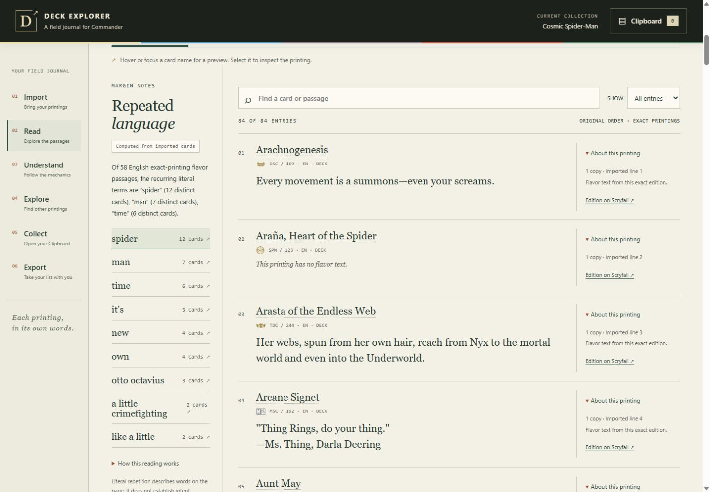

# Deck Explorer

**A field journal for Commander.** Read the flavor text on your deck’s exact printings, follow its mechanics to their sources, and collect discoveries in a separate Clipboard.

[](https://github.com/rboles84/mtg-deck-explorer/actions/workflows/validate.yml)
[User guide](docs/USER_GUIDE.md) · [Verification](#verify-the-project) · [Report a problem](https://github.com/rboles84/mtg-deck-explorer/issues)



*The reading view from a recorded browser check. Each passage stays attached to its printing; an edition with no flavor text is shown as such.*

## What you can do

- **Read your editions.** Import a deck and browse its flavor passages, card faces, and printing details. Supplied printing coordinates are checked; name-only imports show an explicitly labeled assumed printing.
- **Follow the evidence.** Inspect repeated words and short phrases alongside the passages that contain them. Explore mechanic labels with their contributing cards and source references.
- **Find other cards.** Run a mechanic search constrained to your selected commander’s color identity and Scryfall’s Commander legality data.
- **Keep your discoveries.** Save specific printings to a Clipboard and export their quantities, set codes, and collector numbers. Saving never changes the imported deck.

Deck Explorer is a **local prototype**. This repository contains the runnable app; there is no hosted service yet.

## Try it locally

Install [Node.js](https://nodejs.org/) first; the validated version is **24.14.0**. With Git installed, run:

```sh
git clone https://github.com/rboles84/mtg-deck-explorer.git
cd mtg-deck-explorer
node server.mjs
```

Open **[http://127.0.0.1:4173](http://127.0.0.1:4173)**. Stop the server with **Ctrl+C**. There is no package-install or build step, account, or API key.

1. Paste a deck list, or choose a supported `.txt` or `.csv` export. Commander plus main deck must total **100 cards**. To try an included real list, select [`fixtures/cosmicspiderman.txt`](fixtures/cosmicspiderman.txt).
2. Check the import preview, then select **Import deck**. Confirm or choose your commander when needed.
3. Follow **Read → Understand → Explore**, then use **Collect → Export** for saved discoveries.

Real imports, searches, and card images need an internet connection to Scryfall. **Load fixture demo** offers a separate synthetic reading example with invented cards and sample prose; it does not support live discovery.

The [user guide](docs/USER_GUIDE.md) covers import formats, assumed editions, card faces, search limits, Clipboard storage, and troubleshooting.

## How the experience is curated

| What you see | What supports it |
| --- | --- |
| Card text and edition details | Scryfall records tied to the selected printing, with a link back to that edition. |
| Repeated language | Explicit word and phrase rules, with the original passages available to inspect. Copies and identical passages cannot manufacture independent evidence. |
| Mechanics in the deck | Scryfall keyword metadata plus reviewed, bounded matches against Oracle wording and symbols. The interface distinguishes those evidence types. |
| Rules and references | Verbatim Wizards rules or attributed excerpts and links. Card examples, archived articles, designer references, and playtest guidance retain their narrower scope. |
| Discovery results | Reviewed search recipes, deliberate searches, and Commander/color-identity filters. Empty results remain empty. |

A mechanic match may describe a grant, restriction, or reference; it does not prove that a card itself has that ability. A card example also does not establish a general mechanic definition. Missing source support is left explicit.

**No generative-AI model runs in the app.** Analysis uses explicit JavaScript rules and literal matching. The same input and source data produce the same analysis; live Scryfall data can change. The app does not generate card text or mechanic definitions. Development and documentation have used Codex assistance.

## Coverage and limits

The **October 19, 2026 baseline** reconciles **373 names** from Scryfall’s keyword-ability, keyword-action, and ability-word catalogs. Each has a recorded detection scope, source/reference status, and manual search. There are **374 discovery records**, including the pre-existing Eternity Gate entry.

These are dated catalog checks. They do not guarantee detection of every Magic interaction, implicit action, future mechanic, or unrevealed card. The [full reconciliation](reports/catalog-gaps-20261019/reconciliation-373.json) records the individual names; the [six-reference follow-up](reports/six-reference-update-20261019/REPORT.txt) explains the scoped references that remain distinct from general definitions.

Other boundaries matter in everyday use:

- The importer checks the 100-card total, but does **not** establish full deck legality or commander-pair eligibility.
- Repeated-language analysis covers English passages and literal repetition. It does not infer story, theme, power level, or deck quality.
- The Clipboard lasts for the browser tab’s session. Export discoveries you want to keep; the imported deck must be loaded again after a refresh.
- The server binds to localhost. Public hosting needs separate configuration and validation.

## Verify the project

From the repository directory:

```sh
node scripts/build-catalog-gaps.mjs --check
node --test
```

The validated baseline passed **347 tests**, with **zero failures or skips**, and passed [GitHub Actions on Windows and Linux](https://github.com/rboles84/mtg-deck-explorer/actions/runs/39312032952). The [workflow](.github/workflows/validate.yml) repeats these checks on pushes and pull requests. The [`validated-baseline-2026-10-19` tag](https://github.com/rboles84/mtg-deck-explorer/tree/validated-baseline-2026-10-19) preserves that version.

The tests use retained fixtures and local HTTP servers. They check behavior against those inputs; live-provider checks and browser checks are separate evidence.

| To inspect… | Start here |
| --- | --- |
| Literal text analysis | [`public/core.mjs`](public/core.mjs) |
| Mechanic detection and its regression checks | [`public/catalog-gap-index.mjs`](public/catalog-gap-index.mjs), [catalog-gap tests](tests/catalog-gaps.test.mjs) |
| Approved search recipes and provider access | [`lib/catalog.mjs`](lib/catalog.mjs), [`lib/scryfall.mjs`](lib/scryfall.mjs) |
| Source verification and generation checks | [`scripts/build-catalog-gaps.mjs`](scripts/build-catalog-gaps.mjs), [retained source records](reports/catalog-gaps-20261019/sources.json) |
| Browser evidence | [Mechanic rules and card evidence](reports/catalog-gaps-20261019/browser-absorb.png), [playtest reference panel](reports/playtest-links-20261019/kinfall.png) |

The repository includes retained responses, source receipts, and regression fixtures, so it is larger than the app alone. Reports are dated records: an earlier report’s counts or screenshots may precede a later correction. The [validation guide](docs/VALIDATION.md) explains the current checks and evidence layout. Internal plans and unused design/QA artifacts are kept in a local, Git-ignored archive; the [archive receipt](evidence/repository-archive.json) records their hashes.

## Data and privacy

Imported text stays in browser memory. Explicit imports and searches send the necessary card identifiers or queries through the local server to Scryfall. Card images load directly from Scryfall. The server’s temporary caches are held in memory; there is no account, backend deck storage, or telemetry. Clipboard coordinates use browser session storage. See [storage details](docs/USER_GUIDE.md#storage-and-network-access).

## Help improve it

[Open an issue](https://github.com/rboles84/mtg-deck-explorer/issues) with a minimal deck or card example, printing coordinates, expected and observed behavior, and reproduction steps. For a rules or mechanic correction, include the source URL and relevant clause or card. A screenshot helps with layout problems.

## Credits and reuse

Card data and images come from [Scryfall](https://scryfall.com/). Rules and linked official articles come from Wizards of the Coast. Mana and set symbols use Andrew Gioia’s Mana and Keyrune libraries; [pinned versions and third-party notices](public/vendor/SOURCES.md) are retained.

Deck Explorer is an independent fan project. A license for the project’s own code has not yet been selected; existing third-party materials retain their own notices.
